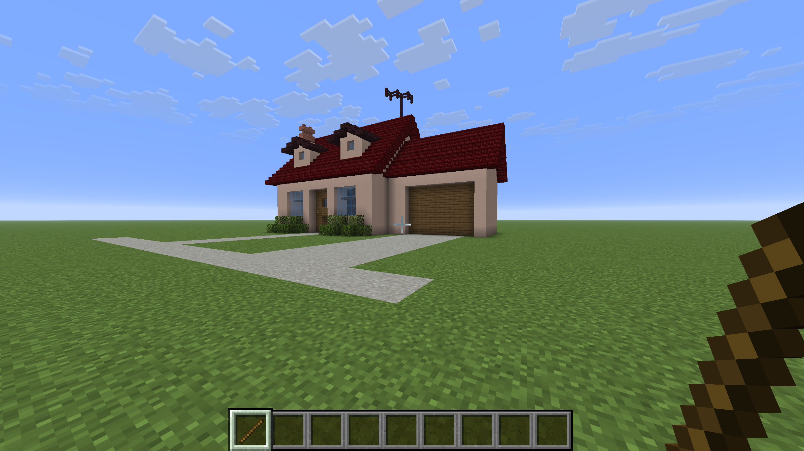
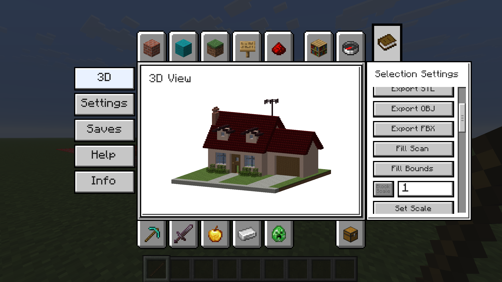
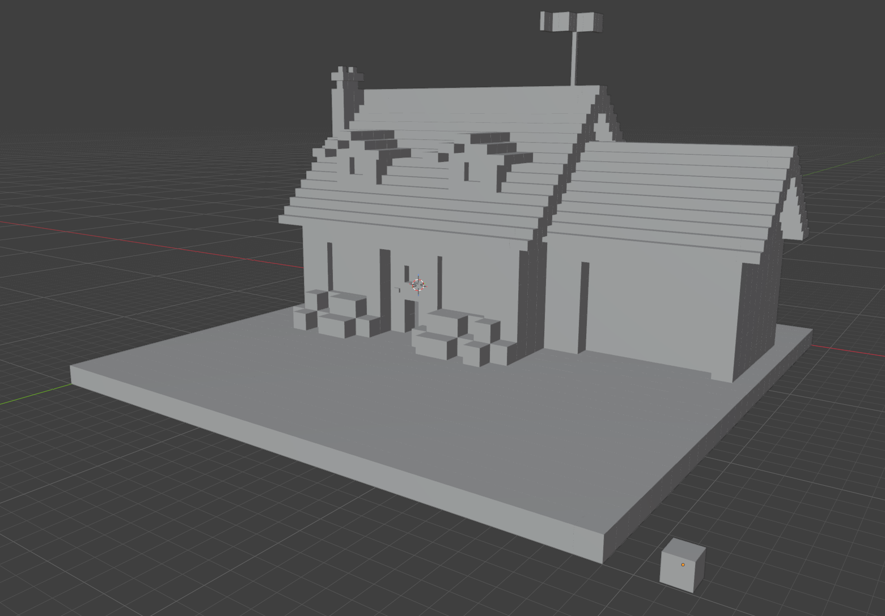

# MineCad

MineCad is an early access Fabric mod that turns Minecraft into a lightweight in-game CAD workflow.
It's designed to help people without the skills needed for advanced 3D modeling software to create sophisticated 3D Models with Minecraft. 

In MineCad you can adjust a block's scale. Typically, in Minecraft 1 block = 1 meter. Well in MineCad, this is dynamic and can be changed. 
1 Block could equal 0.1 Meters, 0.01 Meters, etc., etc. So with enough patience and ingenuity, this can allow for the creation of complicated 3D models all within Minecraft. 

MineCad can of course also be used to export regular builds to the variety of 3D files. 

## Features

- Block selection with wand-style workflows and selection commands
- In-inventory 3D preview tab with camera controls
- Selection tools for save, import, fill, points, and info
- Export support for `STL`, `OBJ`, and `FBX`
- Configurable settings UI (including keybind capture fields)
- Scale control for export units (`selection scale`)


## Using MineCad
Using MineCad is relatively simple, while there are a variety of ways to make a block selection, the simplest of ways is to use the `Wand Tool`.
With the `Wand Tool` you can either individually select all the blocks you want to add, or you can highlight the edges and corners of the entire body of the selection that you want to add,
and then within the `Selection Settings` of the `3D Tab**`, select `Fill Scan`. Fill Scan will calculate the volume between the selected points and add every block within that volume.




Here is an example of a 1m² block in blender compared to our exported object that also has a 1m² relative block size.


## Requirements

- Minecraft: `~26.2` (as configured in this project)
- Fabric Loader: `>=0.19.5`
- Fabric API: `0.159.0+26.2`
- Java: `25+`

## Getting Started (Dev)

Clone and run the client from source:

```powershell
Set-Location "C:\Java Projects\mine-cad"
.\gradlew.bat runClient
```

Build the mod JAR:

```powershell
Set-Location "C:\Java Projects\mine-cad"
.\gradlew.bat build
```

## In-Game UI

MineCad is integrated into the player inventory via a custom tab.

- **3D tab**: inspect selected blocks in a preview scene
- **Settings tab**: tweak mod behavior and keybind strings
- **Saves tab**: currently placeholder text
- **Help / Info tabs**: quick usage notes and project info

The side "Selection Settings" pane includes quick actions for:

- save/import/export
- block scale
- selection fill/list/delete
- point-based tools (`selection points ...`)

## Commands

Main command root:

- `/minecad selection ...`
- `/minecad settings ...`
- `/minecad wand ...`
- `/minecad help`
- `/minecad info`

Examples:

```text
/minecad selection save my_build
/minecad selection import my_build
/minecad selection export stl my_build
/minecad selection points add 0 64 0
/minecad selection scale 0.1
/minecad settings show
```

## Export Notes

- Export uses the configured block scale (`meters per block`)
- STL output reports units in millimeters in command feedback
- Output files are written under the mod data/export paths used by the command system

## Project Layout

- `src/main/java` - common/server-safe logic (commands, settings model, selection/export pipeline)
- `src/client/java` - client UI, tabs, 3D viewport, client-only input/render behavior
- `src/client/resources` - bundled default settings JSON and client assets

## Status

This is an active development project and some metadata placeholders still exist (for example in `fabric.mod.json`).
Expect iteration on UI polish, settings UX, and docs over time.

## License

This repository is licensed under **MIT**.
See `LICENSE` for full text.
